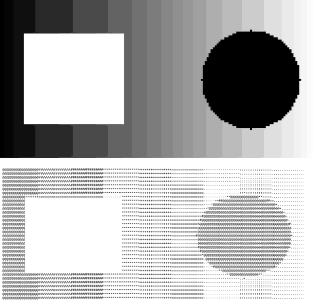

# Conversor de imagem PPM para ASCII art em C

Programa de terminal que lê uma imagem no formato **PPM binário (P6)**, converte cada região da imagem num caractere conforme o brilho, mostra o resultado na tela e salva a arte num arquivo `.txt`. Trabalho da disciplina **Programação Imperativa** do curso de Engenharia de Computação da PUCPR.



## Como funciona

1. **Leitura e validação:** abre o arquivo em modo binário e confere a assinatura `P6`. Depois lê largura, altura e valor máximo de cor, ignorando comentários (`#`) do cabeçalho.
2. **Pixels na memória:** aloca com `malloc` um buffer de `largura × altura × 3` bytes (R, G, B) e lê tudo de uma vez com `fread`.
3. **Redimensionamento:** a arte tem no máximo 200 colunas. A altura é corrigida por um fator de proporção (0,43), porque um caractere no terminal é mais alto do que largo.
4. **Conversão:** cada caractere corresponde a um bloco de pixels. O programa calcula a média de R, G e B do bloco e a luminância:

   ```
   L = 0,299·R + 0,587·G + 0,114·B
   ```

   O verde tem mais peso porque o olho humano é mais sensível a ele. A luminância vira um índice na paleta `@%#*+=-:. `, do mais escuro ao mais claro.
5. **Saída:** imprime a arte no terminal e grava no arquivo com o mesmo nome da imagem e extensão `.txt` (`foto.ppm` → `foto.txt`).

## Como compilar e executar

```bash
gcc -Wall -std=c99 -o ppm2ascii ppm2ascii.c
./ppm2ascii
```

```
Digite o nome do arquivo de imagem PPM: exemplos/formas.ppm
```

A pasta [`exemplos/`](exemplos) tem uma imagem de teste (`formas.ppm`) e a saída gerada a partir dela (`formas.txt`).

Para converter outras imagens para PPM, use o GIMP (Exportar como → PPM, formato "Raw") ou o ImageMagick: `magick foto.jpg foto.ppm`.

## Estrutura

```
ppm2ascii.c   código-fonte completo
exemplos/     imagem de teste e a arte ASCII gerada
```

---

Frederico Assis Castellano · Engenharia de Computação, PUCPR
